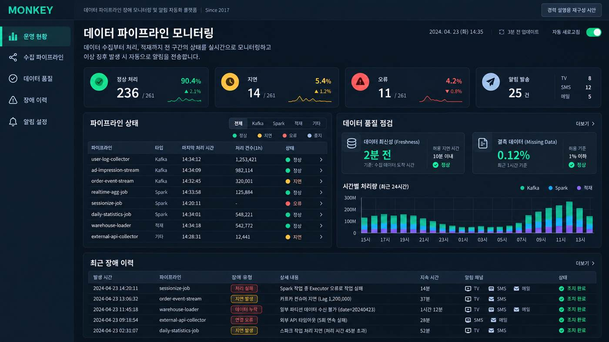
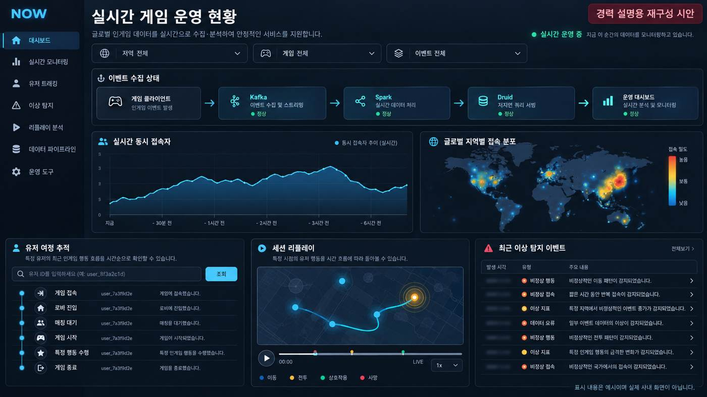
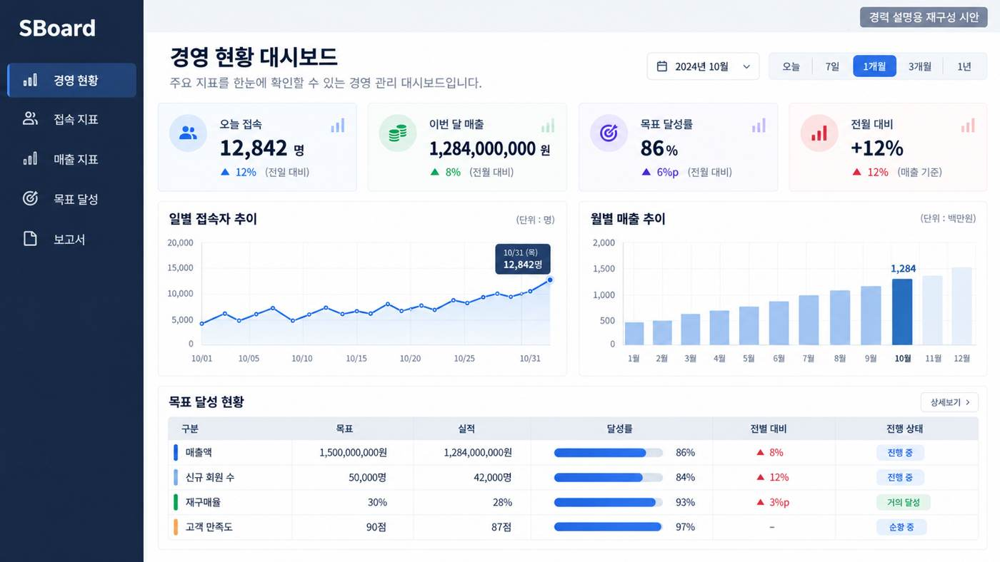
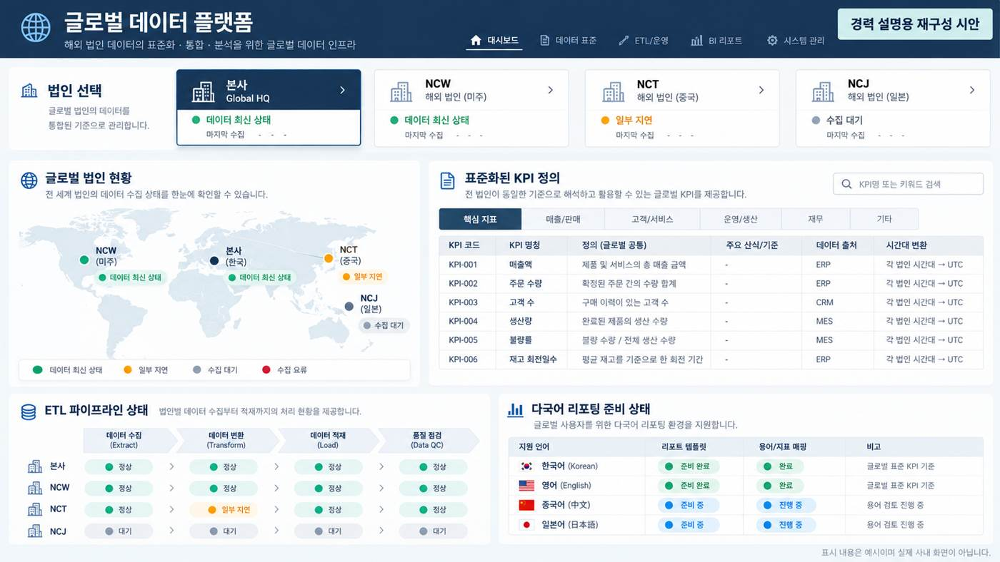

# 임종주 | 경력기술서

프로젝트 리딩 · 고객 경험 · 데이터와 웹 서비스 개발

[이력서](https://ifreeda7.github.io/resume.html) · [프로젝트 포트폴리오](https://ifreeda7.github.io/#work) · [PDF 다운로드](https://ifreeda7.github.io/career_history.pdf)

## PLUTUS | 금융 데이터 제품

개인 프로젝트 · 기획, 데이터·화면 설계, 개발, 배포·운영

**고객 문제**

시장 지표, 종목 후보, 거래대금·수급과 뉴스가 흩어져 있어 투자 판단에 필요한 정보를 오가며 확인해야 했습니다. 지표마다 기준일과 갱신 주기도 달라 숫자의 최신성을 해석하기 어려웠습니다.

**제품 결정과 구현**

- 매크로 지표 대시보드와 조건검색·종목 분석·매매일지를 연결한 웹 서비스를 개발·공개했습니다.
- 로그인 전에 서비스 가치와 무료 이용을 안내하는 공개 소개 페이지를 마련했습니다.
- 지표 기준일·수집 시각·누락·지연을 구분하는 개선 과제를 정의해 데이터 해석과 화면 표시를 다듬었습니다.
- 자체 MCP·Report API·WordPress를 연결해 AI 도구에서 보고서를 전달하고 초안으로 처리하는 흐름을 구현했습니다.

**현재 서비스**

[매크로 지표 대시보드](https://macro.plutus.ai.kr/) · [매매 분석 웹](https://trade.plutus.ai.kr/) · [PLUTUS 리포트](https://plutus.ai.kr/)

## MONKEY | 장애 모니터링 자동화 플랫폼

2017–2024 · 엔씨소프트 · PM·PL, 메인 개발·운영

**고객 문제**

운영자는 메일에 분산된 적재 장애 정보를 확인해야 했습니다. 개별 알림으로 현재 상태와 대응 대상을 파악하기 어려웠고, 제한된 개발·운영 인력에서 반복 확인 업무를 줄여야 했습니다.

**담당한 결정과 실행**

- 운영자 인터뷰로 확인·알림 업무를 분석하고, 적재 품질·장애 상태를 함께 보는 서비스로 기획했습니다.
- 백엔드·프론트엔드·운영을 맡아 관리자 웹, 사무실 TV 대시보드, SMS·이메일 알림을 구현했습니다.
- 사용자 인터뷰와 운영 피드백을 이어가며 반복 업무를 자동화하고, 서비스 확장 시 후속 개발·운영 인력의 업무 정착을 이끌었습니다.

**만든 변화**

메일을 개별 확인하던 업무를 공통 화면에서 상태를 파악하고 알림으로 대응하는 흐름으로 전환했습니다. 데이터 적재 품질과 장애 통지를 통합한 운영 서비스로 정착했습니다.

## NOW | 글로벌 실시간 인게임 모니터링

2019–2024 · 엔씨소프트 · PL, 데이터 설계·메인 개발, UI/UX 기획

**고객 문제**

정기 집계만으로는 게임 운영 중 발생하는 이상 현황과 이용자 활동을 즉시 확인하기 어려웠습니다.

**담당한 설계와 개발**

- Spark·Kafka 로그 처리와 Druid 저지연 조회 환경에서 실시간 데이터 구조와 조회 흐름을 설계했습니다.
- 사업부의 요구를 다중 필터·유저 트래킹·이상 현상 알림·플레이백 기능으로 구체화하고 화면을 구현했습니다.
- React 초기 화면 구축과 Next.js 개편을 리드했습니다. 화면 구조·인터랙션·디자인 방향을 직접 다루고 사용자의 탐색 흐름을 개편에 반영했습니다.

**만든 변화**

정기 통계 조회를 넘어 실시간 로그에서 특정 이용자와 이상 상황을 찾아 대응할 수 있는 서비스를 제공했습니다.

## SBoard | 경영 정보 포털

2016–2024 · 엔씨소프트 · 서비스 기획, 데이터 설계, 풀스택 개발·운영

**고객 문제**

경영진과 전략기획실이 접속·매출·목표 달성 현황을 일관된 기준과 빠른 화면으로 확인해야 했습니다.

**담당한 설계와 개발**

- 전략기획실과 KPI와 조회 흐름을 정의하고 데이터 모델·ETL·Python/Django API·React 화면을 직접 연결했습니다.
- 데이터 표준화, ETL·조회 경로 최적화와 캐싱을 적용하고 권한 관리·암호화·보안 감사 대응을 담당했습니다.
- 데이터 도달 **1분**, 집계 **15초**, 화면 렌더링 **1초**를 목표로 처리 구조를 설계·운영했습니다.

| 단계 | 설계 목표 |
|---|---|
| 데이터 도달 | 1분 단위 |
| 집계 | 15초 |
| 화면 렌더링 | 1초 |

**개편 경험**

두 차례 대규모 개편을 주도하며 사용자 피드백에 맞춰 지표 체계와 화면 구성을 재정리했습니다.

## OASIS | 데이터 정보 포털

2010–2016 · 엔씨소프트 · 원천 수집, DW/DM, ETL, BI 개발·운영

빌링·웹로그·인게임 로그를 수집·정제하고 Oracle·SQL Server 기반 DW/DM과 Cognos·Tableau 리포트를 개발했습니다. 게임 XML에서 차원 데이터를 자동 갱신하는 기능을 Python·Java로 구현했습니다.

블레이드 앤 소울 론칭 때 **40건 이상의 대시보드·통계 보고서**를 기한 내 제공했습니다.

## 글로벌 데이터 플랫폼 | NCW·NCT·NCJ

2010 · 2014 · 2019 · 엔씨소프트 · 요구사항 분석, 데이터 표준화, DW·ETL·BI 설계·교육

- 해외 **3개 지사**의 데이터·인프라 요구를 조사하고 공통 KPI·로그 기준을 정의했습니다.
- 다국어·타임존 요구를 반영한 DW·ETL 설계, 초기 BI 리포트, 운영자 교육을 맡았습니다.
- NCT 구축에서는 요구사항과 운영 기준을 문서로 정리했습니다.

## 추가 제품과 교육 경험

- **[TokenWatch](https://tokenwatch.aject.co.kr/):** AI 모델의 API 가격·구독료·무료 이용 범위·성능을 비교하는 웹 서비스 개발·배포.
- **[AJECT](https://aject.co.kr/):** Next.js·PostgreSQL 기반 웹, 문의·관리자 화면·이메일 알림 구축과 Ubuntu·Nginx·systemd 운영.
- **Hive·SQL 사내 교육:** 데이터 조직과 유관 부서 대상 강의, 2016–2018.

*기업 프로젝트 이미지는 경력 설명을 위해 재구성한 시안이며, 표시된 데이터와 화면 상태는 예시입니다.*
